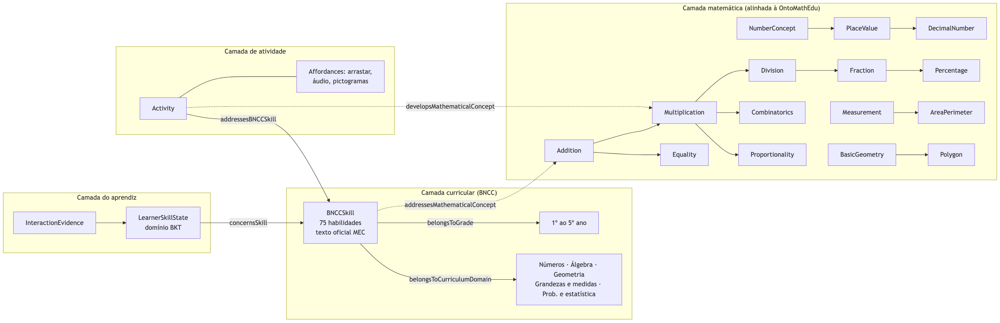
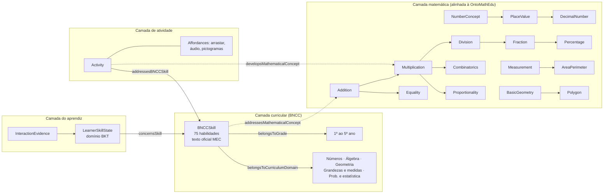
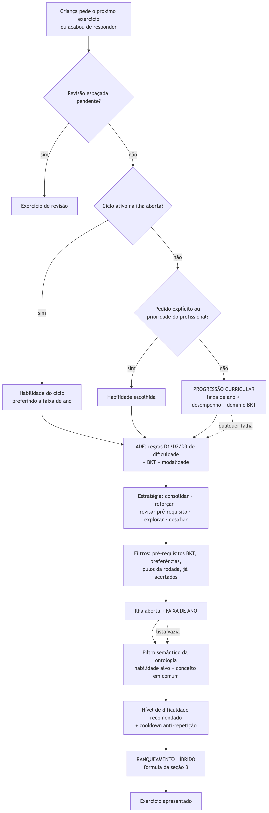
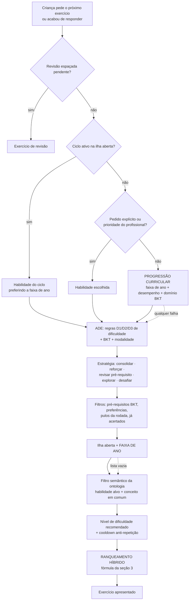
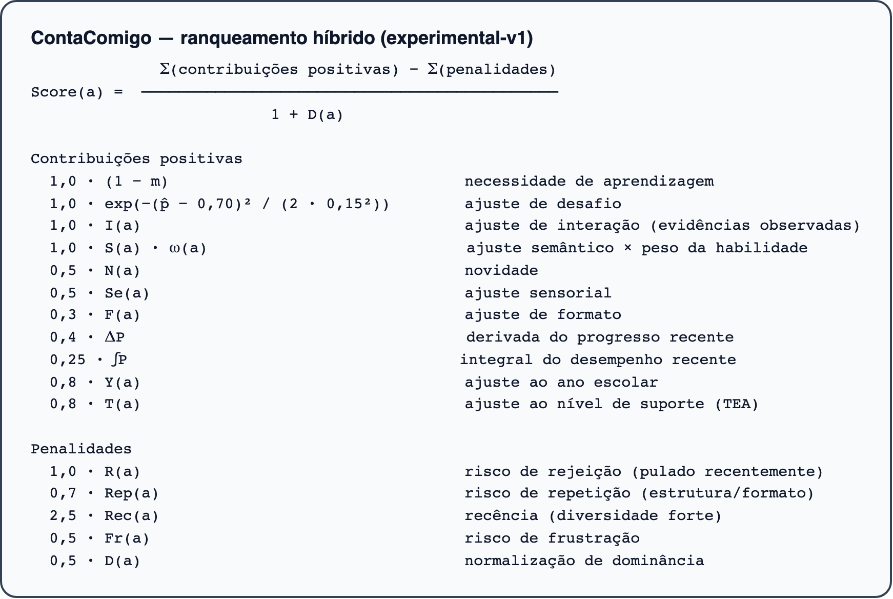

# Batch 16 — Ontologia v0.5.0, motor de seleção e fórmula de ranqueamento

As imagens deste documento estão em `docs/research/img/` e foram geradas a partir dos diagramas Mermaid abaixo (que o GitHub também renderiza).

## 1. Ontologia ContaComigo v0.5.0

[PROPOSTA CONTA COMIGO]





As setas cheias dentro da camada matemática são as 11 relações `PrerequisiteRelation` (pré-requisito → dependente). Fraction e DecimalNumber aparecem sem seta vinda de NumberConcept porque são **subclasses** dele, e não dependentes. As setas pontilhadas indicam a ligação genérica entre camadas (cada habilidade e cada atividade apontam para os seus conceitos).

[LITERATURA]

Cada pré-requisito cita o trecho da BNCC que o sustenta (por exemplo, multiplicação "com a ideia de adição de parcelas iguais", EF02MA07/EF03MA07; frações associadas "ao resultado de uma divisão", EF05MA03). Apenas "multiplicação → divisão" está marcado `needs_professional_review`, porque a BNCC sustenta a relação inversa (EF04MA13), mas apresenta a divisão por repartição junto com a multiplicação no 2º e no 3º ano.

[DECISÃO DE ENGENHARIA]

- Só foram criados pré-requisitos cujo conceito dependente é novo. Por isso, as relações entre as 6 habilidades originais de 1º ano não mudaram.
- Uma habilidade de ano posterior nunca é apresentada como pré-requisito de uma anterior.
- O mapeamento habilidade → conceito no código espelha a ontologia, e um teste garante essa consistência.

## 2. Motor de seleção do próximo exercício

[PROPOSTA CONTA COMIGO]





Os itens em maiúsculas foram criados ou alterados neste batch. Todo filtro novo tem válvula de segurança: se esvaziar a lista, mantém o comportamento anterior. `ADE_YEAR_PROGRESSION_ENABLED=false` desliga toda a progressão.

### Regras da progressão curricular

[PARÂMETRO EXPERIMENTAL]

Todas reutilizam parâmetros que já existiam no ADE:

| Regra | Definição | Parâmetro |
|---|---|---|
| Desempenho forte | acerto ≥ 0,8 nas últimas 5 tentativas | `ADE_STRATEGY_RECENT_WINDOW`, `ADE_EXPLORE_MASTERY_THRESHOLD` |
| Dificuldade | ≥ 2 erros nas últimas 5 tentativas | `ADE_REINFORCE_MIN_ERRORS` |
| Faixa de ano (padrão) | do ano escolar − 1 ao ano escolar + 1 | mesma regra do motor de templates |
| Faixa com desempenho forte | o piso sobe até o ano em que a criança está acertando | — |
| Faixa com dificuldade ou revisão | o piso desce até o 1º ano | — |
| Avançar de habilidade | 3 acertos seguidos sem dica e domínio BKT ≥ 0,8 | `ADE_EXPLORE_MIN_INDEPENDENT_SUCCESSES` |
| Próxima habilidade | não dominada, mesmo ano ou acima, preferindo conceito em comum (ontologia) | — |

Sem ano escolar no perfil, não há teto, e o piso vem só do desempenho.

[LITERATURA]

O teto de "um ano acima" segue a zona de desenvolvimento proximal (VYGOTSKY, 1978). Avançar só depois de evidência repetida e de domínio estimado segue a lógica de *mastery learning* usada no rastreamento de conhecimento (CORBETT; ANDERSON, 1995).

## 3. Fórmula final de ranqueamento

[PROPOSTA CONTA COMIGO]



Para cada candidato *a* que passou pelos filtros:

```
              Σ(contribuições positivas) − Σ(penalidades)
Score(a) =  ─────────────────────────────────────────────
                          1 + D(a)

Contribuições positivas
  1,0 · (1 − m)                                necessidade de aprendizagem
  1,0 · exp(−(p̂ − 0,70)² / (2 · 0,15²))        ajuste de desafio
  1,0 · I(a)                                   ajuste de interação (evidências observadas)
  1,0 · S(a) · ω(a)                            ajuste semântico × peso da habilidade
  0,5 · N(a)                                   novidade
  0,5 · Se(a)                                  ajuste sensorial
  0,3 · F(a)                                   ajuste de formato
  0,4 · ΔP                                     derivada do progresso recente
  0,25 · ∫P                                    integral do desempenho recente
  0,8 · Y(a)                                   ajuste ao ano escolar
  0,8 · T(a)                                   ajuste ao nível de suporte (TEA)

Penalidades
  1,0 · R(a)                                   risco de rejeição (pulado recentemente)
  0,7 · Rep(a)                                 risco de repetição (estrutura/formato)
  2,5 · Rec(a)                                 recência (diversidade forte)
  0,5 · Fr(a)                                  risco de frustração
  0,5 · D(a)                                   normalização de dominância
```

Em que:

- *m* é o domínio BKT da habilidade alvo;
- *p̂* = clamp(*m* + 0,5 − *d*) é a chance prevista de acerto, sendo *d* a dificuldade do candidato;
- *Y(a)* = 1 se o ano do exercício é o ano da criança, e 1 − 0,1·|Δano| nos demais casos;
- *D(a)* reduz o efeito de um único fator dominante.

Todos os pesos são configuráveis por variável de ambiente (`HYBRID_WEIGHT_*`), e a configuração é registrada em cada decisão como `experimental-v1`.

[LITERATURA]

- O alvo de sucesso de 0,70 com dispersão de 0,15 operacionaliza a ideia de manter a criança numa dificuldade desafiadora, porém alcançável. Wilson et al. (2019) mostram, em modelos de aprendizagem, um ótimo próximo de 85% de acerto; o valor 0,70 do sistema é mais conservador e precisa de calibração.
- O domínio *m* vem do BKT clássico (CORBETT; ANDERSON, 1995), com P(L₀) = 0,1, P(T) = 0,1, P(G) = 0,25 e P(S) = 0,10. Pelánek (2017) discute os limites e a calibração desses parâmetros.

[HIPÓTESE A VALIDAR]

Os pesos não foram calibrados com dados. O fator de ano *Y* tem peso pequeno no ranking (diferença máxima de 0,8 · 0,4 = 0,32 pontos), e por isso a progressão por ano foi implementada como **filtro** antes do ranking, e não só como peso.

## 4. Métricas de Learning Analytics

[LITERATURA]

As métricas calculadas em `learning-analytics-metrics.service.ts` correspondem a indicadores usuais da área (SIEMENS; LONG, 2011; BAKER; INVENTADO, 2014):

| Métrica | Definição no sistema | Uso |
|---|---|---|
| Acerto | respostas corretas / respostas enviadas | desempenho |
| Conclusão | concluídas / iniciadas | engajamento |
| Pulos | puladas / apresentadas | rejeição e adequação |
| Tentativas médias | respostas / instâncias respondidas | persistência |
| Tempo médio de resposta | média de `responseTimeMs` | fluência e sobrecarga |
| Uso de dica | com dica / iniciadas | busca de ajuda (ALEVEN et al., 2006) |
| Repetição da instrução | instrução repetida / iniciadas | carga de linguagem |

[HIPÓTESE A VALIDAR]

O Batch 01 registrava que faltavam referências verificadas para essas métricas; este documento as fornece. Ainda **não** há validação das métricas com a população atendida (crianças com TEA), nem limiares calibrados para elas. Tempo de resposta e uso de dica podem ter significados diferentes nesse público (por exemplo, dica usada como regulação, e não por dificuldade).

## Referências

[LITERATURA]

- ALEVEN, V. et al. Toward meta-cognitive tutoring: a model of help seeking with a Cognitive Tutor. *International Journal of Artificial Intelligence in Education*, v. 16, n. 2, p. 101–128, 2006.
- BAKER, R. S.; INVENTADO, P. S. Educational data mining and learning analytics. In: LARUSSON, J. A.; WHITE, B. (ed.). *Learning Analytics: From Research to Practice*. New York: Springer, 2014. p. 61–75.
- BRASIL. Ministério da Educação. *Base Nacional Comum Curricular*. Brasília: MEC, 2018.
- CORBETT, A. T.; ANDERSON, J. R. Knowledge tracing: modeling the acquisition of procedural knowledge. *User Modeling and User-Adapted Interaction*, v. 4, n. 4, p. 253–278, 1995.
- PELÁNEK, R. Bayesian knowledge tracing, logistic models, and beyond: an overview of learner modeling techniques. *User Modeling and User-Adapted Interaction*, v. 27, p. 313–350, 2017.
- SIEMENS, G.; LONG, P. Penetrating the fog: analytics in learning and education. *EDUCAUSE Review*, v. 46, n. 5, p. 30–40, 2011.
- VYGOTSKY, L. S. *Mind in Society: The Development of Higher Psychological Processes*. Cambridge, MA: Harvard University Press, 1978.
- WILSON, R. C. et al. The Eighty Five Percent Rule for optimal learning. *Nature Communications*, v. 10, art. 4646, 2019.

## Texto potencial para a dissertação

### Metodologia

A ontologia foi ampliada para 75 habilidades da BNCC, com 18 conceitos matemáticos locais e 11 relações de pré-requisito, cada uma justificada por um trecho do texto oficial. O motor de seleção combina regras explícitas (dificuldade D1–D3, estratégias de reforço, revisão e exploração), filtragem semântica pela ontologia, rastreamento bayesiano de conhecimento e uma função de ranqueamento híbrida com fatores e pesos registrados em cada decisão.

### Decisão de projeto

A adequação ao ano escolar passou a ser um filtro com válvulas de segurança, e não apenas um peso no ranqueamento. O peso original era insuficiente para impedir a recomendação de conteúdo de 1º ano a crianças com bom desempenho em anos posteriores.

### Limitações

Os pesos do ranqueamento e os limiares da progressão não foram calibrados empiricamente. Os pré-requisitos são relações entre conceitos derivadas do texto curricular, e não de dados de aprendizagem. As métricas de Learning Analytics não foram validadas para crianças com TEA.

### Evidência necessária no experimento

Comparar, antes e depois da ativação da progressão (com `ADE_YEAR_PROGRESSION_ENABLED` como chave experimental), a distribuição de anos escolares dos exercícios recomendados, a taxa de acerto, os pulos e o tempo até o domínio por habilidade. Usar esses dados para calibrar os pesos `HYBRID_WEIGHT_*` e os limiares da progressão.
