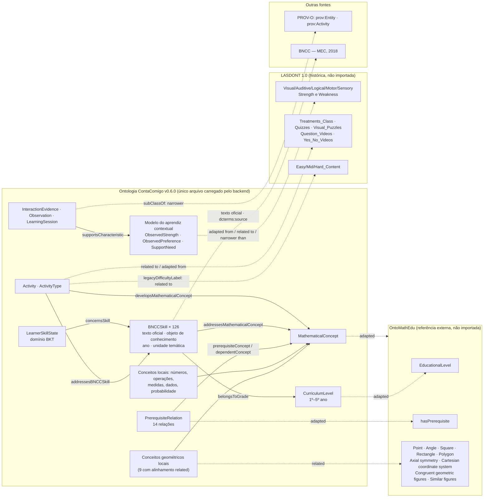

# Batch 18 — Ontologia v0.6.0: todas as habilidades BNCC do 1º ao 5º ano e alinhamentos com OntoMathEdu e LASDONT

Este documento registra a passagem da ontologia `ontology/contacomigo/contacomigo.owl` da versão 0.5.0 para a 0.6.0. A mudança tem dois objetivos: (1) dar um indivíduo próprio a cada habilidade de Matemática da BNCC do 1º ao 5º ano, e (2) deixar explícito, para uso em artigo, como a ontologia ContaComigo se relaciona com a OntoMathEdu e com a LASDONT.

## 1. Escopo e resultado

[PROPOSTA CONTA COMIGO]

- A v0.5.0 tinha 75 habilidades BNCC como indivíduos `cc:BNCCSkill`. A v0.6.0 tem 126, ou seja, todas as habilidades de Matemática do 1º ao 5º ano.
- As 51 habilidades novas seguem o mesmo padrão das existentes: código, texto oficial (`cc:hasOfficialDescription`), ano (`cc:belongsToGrade`), unidade temática (`cc:belongsToCurriculumDomain`), currículo, conceitos matemáticos (`cc:addressesMathematicalConcept`), situação do mapeamento, cobertura por atividades e fonte (`dcterms:source`).
- Nova propriedade `cc:hasKnowledgeObject` (objeto de conhecimento), preenchida para as 126 habilidades com o texto dos quadros oficiais.
- Quatro conceitos locais novos (`SpatialLocationConcept`, `ProbabilityConcept`, `CongruenceConcept`, `SimilarityConcept`) e três relações de pré-requisito novas.
- Inventário de procedência (OntoMathEdu, LASDONT, PROV-O, BNCC e conceitos próprios), com diagrama das pontes (seções 6 a 8).

[DECISÃO DE ENGENHARIA]

Nenhuma IRI existente foi removida ou renomeada. O backend continua a carregar um único arquivo, e todas as IRIs que ele usa (`cc:BNCCSkill`, `cc:hasCurriculumCode`, `cc:belongsToGrade`, `cc:addressesMathematicalConcept`, `cc:PrerequisiteRelation`, `cc:prerequisiteConcept`, `cc:dependentConcept` e a IRI da ontologia) foram mantidas. O `owl:versionInfo` passou a `0.6.0`, e as mudanças estão resumidas num `skos:changeNote` no cabeçalho da ontologia.

## 2. Verificação da lista e origem dos textos oficiais

[DECISÃO DE ENGENHARIA]

A lista das 51 habilidades sem indivíduo foi conferida contra o OWL 0.5.0 antes da edição: 16 do 1º ano, 11 do 2º, 11 do 3º, 7 do 4º e 6 do 5º. A lista bateu exatamente com a pedida, sem discrepâncias.

[LITERATURA]

Os textos das habilidades vêm de `backend/src/database/seeds/data/bncc-matematica-anos-iniciais.json`, que já existia no repositório (126 habilidades, extraídas do PDF oficial do MEC). Para não depender só desse arquivo, o PDF oficial (BRASIL, 2018) foi baixado e os quadros de Matemática do 1º ao 5º ano foram extraídos automaticamente (pdfplumber). Resultado da comparação:

- **126 de 126 descrições idênticas** ao PDF. Só foram normalizadas aspas tipográficas, hifenização de quebra de linha e o número da página que aparece após a última habilidade de cada página.
- **Unidade temática idêntica** em 126 de 126.
- As 75 descrições que já estavam no OWL 0.5.0 também são idênticas ao JSON. Nenhum texto existente precisou de correção.

Portanto, **não há habilidade com texto não verificado**. O arquivo `bncc-skills.seed.ts` tem versões resumidas ou adaptadas de alguns textos (por exemplo, EF01MA16 e EF01MA17). Por isso, ele **não** foi usado como fonte.

[DECISÃO DE ENGENHARIA]

O **objeto de conhecimento** não estava em nenhum arquivo do repositório com texto oficial: o campo `knowledgeObject` de `bncc-skills.seed.ts` é uma paráfrase do projeto. Ele foi extraído das linhas da tabela do PDF, usando a caixa de cada célula da coluna "Objetos de conhecimento" para associá-la às habilidades da mesma linha. As 126 habilidades receberam exatamente uma linha da tabela. Quando a célula traz mais de um objeto (por exemplo, "Leitura, escrita e comparação de números naturais (até 100)" e "Reta numérica"), cada objeto virou um valor de `cc:hasKnowledgeObject`. Isso aconteceu em 7 linhas: EF01MA01, EF01MA04/05, EF01MA22, EF03MA03/04, EF04MA16, EF04MA28 e EF05MA12/13. O "3" sobrescrito de "cm³" (EF02MA17) foi conferido pelo tamanho da fonte no PDF. A BNCC não associa objetos a habilidades individualmente dentro de uma linha, e a ontologia preserva essa granularidade, sem inventar uma correspondência mais fina.

## 3. Cobertura antes e depois

[PROPOSTA CONTA COMIGO]

| Ano | Habilidades BNCC de Matemática | Na ontologia v0.5.0 | Na ontologia v0.6.0 | Adicionadas |
| --- | ---: | ---: | ---: | ---: |
| 1º ano | 22 | 6 | 22 | 16 |
| 2º ano | 23 | 12 | 23 | 11 |
| 3º ano | 28 | 17 | 28 | 11 |
| 4º ano | 28 | 21 | 28 | 7 |
| 5º ano | 25 | 19 | 25 | 6 |
| **Total** | **126** | **75 (59,5%)** | **126 (100%)** | **51** |

Esta tabela mede **representação na ontologia**, e não cobertura por exercícios. A cobertura por exercícios fica em `cc:currentActivityCoverageStatus`. Das 51 habilidades novas, só EF01MA02, EF01MA04, EF01MA05 e EF01MA13 aparecem em exercícios semeados (`activities.seed.ts` e os geradores que ele inclui) e receberam `PARTIALLY_COVERED`. As outras 47 receberam `NOT_COVERED` com `cc:currentActivityCount` igual a 0. EF01MA13 tem um exercício estático (contagem 1). Para EF01MA02/04/05, os exercícios vêm de geradores paramétricos, e por isso a contagem não foi materializada, o que está anotado no próprio indivíduo. Atribuir habilidades de ilha (`island-exercises-mapping.seed.ts`) não foi contado como exercício.

## 4. Habilidades adicionadas

[PROPOSTA CONTA COMIGO]

Todas têm `cc:conceptMappingStatus` = `partial` e o comentário "Mapeamento habilidade-conceito proposto pelo ContaComigo (v0.6.0) a partir do texto oficial; aguarda revisão profissional", como as habilidades da v0.5.0. Cada asserção `addressesMathematicalConcept` tem um `owl:Axiom` com `cc:mappingOrigin` = "ContaComigo semantic analysis" (184 de 184 asserções da ontologia anotadas). O texto oficial completo de cada habilidade está no OWL.

| Código | Unidade temática | Objeto(s) de conhecimento (texto oficial) | Conceitos (`addressesMathematicalConcept`) | Cobertura atual |
| --- | --- | --- | --- | --- |
| EF01MA02 | Números | Quantificação de elementos de uma coleção: estimativas, contagem um a um, pareamento ou outros agrupamentos e comparação | `CountingConcept` | PARTIALLY_COVERED |
| EF01MA04 | Números | Leitura, escrita e comparação de números naturais (até 100) · Reta numérica | `CountingConcept`, `NumberConcept` | PARTIALLY_COVERED |
| EF01MA05 | Números | Leitura, escrita e comparação de números naturais (até 100) · Reta numérica | `NumberConcept`, `ComparisonConcept` | PARTIALLY_COVERED |
| EF01MA09 | Álgebra | Padrões figurais e numéricos: investigação de regularidades ou padrões em sequências | `SequencePatternConcept`, `ComparisonConcept` | NOT_COVERED |
| EF01MA10 | Álgebra | Sequências recursivas: observação de regras usadas utilizadas em seriações numéricas (mais 1, mais 2, menos 1, menos 2, por exemplo) | `SequencePatternConcept` | NOT_COVERED |
| EF01MA11 | Geometria | Localização de objetos e de pessoas no espaço, utilizando diversos pontos de referência e vocabulário apropriado | `SpatialLocationConcept` | NOT_COVERED |
| EF01MA12 | Geometria | Localização de objetos e de pessoas no espaço, utilizando diversos pontos de referência e vocabulário apropriado | `SpatialLocationConcept` | NOT_COVERED |
| EF01MA13 | Geometria | Figuras geométricas espaciais: reconhecimento e relações com objetos familiares do mundo físico | `SpatialFigureConcept` | PARTIALLY_COVERED |
| EF01MA15 | Grandezas e medidas | Medidas de comprimento, massa e capacidade: comparações e unidades de medida não convencionais | `MeasurementConcept`, `ComparisonConcept` | NOT_COVERED |
| EF01MA16 | Grandezas e medidas | Medidas de tempo: unidades de medida de tempo, suas relações e o uso do calendário | `TimeMeasurementConcept` | NOT_COVERED |
| EF01MA17 | Grandezas e medidas | Medidas de tempo: unidades de medida de tempo, suas relações e o uso do calendário | `TimeMeasurementConcept` | NOT_COVERED |
| EF01MA18 | Grandezas e medidas | Medidas de tempo: unidades de medida de tempo, suas relações e o uso do calendário | `TimeMeasurementConcept` | NOT_COVERED |
| EF01MA19 | Grandezas e medidas | Sistema monetário brasileiro: reconhecimento de cédulas e moedas | `MoneyConcept` | NOT_COVERED |
| EF01MA20 | Probabilidade e estatística | Noção de acaso | `ProbabilityConcept` | NOT_COVERED |
| EF01MA21 | Probabilidade e estatística | Leitura de tabelas e de gráficos de colunas simples | `DataInterpretationConcept` | NOT_COVERED |
| EF01MA22 | Probabilidade e estatística | Coleta e organização de informações · Registros pessoais para comunicação de informações coletadas | `DataInterpretationConcept` | NOT_COVERED |
| EF02MA02 | Números | Leitura, escrita, comparação e ordenação de números de até três ordens pela compreensão de características do sistema de numeração decimal (valor posicional e papel do zero) | `CountingConcept` | NOT_COVERED |
| EF02MA10 | Álgebra | Identificação de regularidade de sequências e determinação de elementos ausentes na sequência | `SequencePatternConcept` | NOT_COVERED |
| EF02MA12 | Geometria | Localização e movimentação de pessoas e objetos no espaço, segundo pontos de referência, e indicação de mudanças de direção e sentido | `SpatialLocationConcept` | NOT_COVERED |
| EF02MA13 | Geometria | Esboço de roteiros e de plantas simples | `SpatialLocationConcept` | NOT_COVERED |
| EF02MA16 | Grandezas e medidas | Medida de comprimento: unidades não padronizadas e padronizadas (metro, centímetro e milímetro) | `MeasurementConcept` | NOT_COVERED |
| EF02MA17 | Grandezas e medidas | Medida de capacidade e de massa: unidades de medida não convencionais e convencionais (litro, mililitro, cm³, grama e quilograma) | `MeasurementConcept` | NOT_COVERED |
| EF02MA19 | Grandezas e medidas | Medidas de tempo: intervalo de tempo, uso do calendário, leitura de horas em relógios digitais e ordenação de datas | `TimeMeasurementConcept` | NOT_COVERED |
| EF02MA20 | Grandezas e medidas | Sistema monetário brasileiro: reconhecimento de cédulas e moedas e equivalência de valores | `MoneyConcept` | NOT_COVERED |
| EF02MA21 | Probabilidade e estatística | Análise da ideia de aleatório em situações do cotidiano | `ProbabilityConcept` | NOT_COVERED |
| EF02MA22 | Probabilidade e estatística | Coleta, classificação e representação de dados em tabelas simples e de dupla entrada e em gráficos de colunas | `DataInterpretationConcept` | NOT_COVERED |
| EF02MA23 | Probabilidade e estatística | Coleta, classificação e representação de dados em tabelas simples e de dupla entrada e em gráficos de colunas | `DataInterpretationConcept` | NOT_COVERED |
| EF03MA05 | Números | Procedimentos de cálculo (mental e escrito) com números naturais: adição e subtração | `AdditionConcept`, `SubtractionConcept`, `EarlyProblemSolvingConcept` | NOT_COVERED |
| EF03MA12 | Geometria | Localização e movimentação: representação de objetos e pontos de referência | `SpatialLocationConcept` | NOT_COVERED |
| EF03MA16 | Geometria | Congruência de figuras geométricas planas | `CongruenceConcept` | NOT_COVERED |
| EF03MA17 | Grandezas e medidas | Significado de medida e de unidade de medida | `MeasurementConcept` | NOT_COVERED |
| EF03MA19 | Grandezas e medidas | Medidas de comprimento (unidades não convencionais e convencionais): registro, instrumentos de medida, estimativas e comparações | `MeasurementConcept` | NOT_COVERED |
| EF03MA20 | Grandezas e medidas | Medidas de capacidade e de massa (unidades não convencionais e convencionais): registro, estimativas e comparações | `MeasurementConcept` | NOT_COVERED |
| EF03MA21 | Grandezas e medidas | Comparação de áreas por superposição | `AreaPerimeterConcept` | NOT_COVERED |
| EF03MA25 | Probabilidade e estatística | Análise da ideia de acaso em situações do cotidiano: espaço amostral | `ProbabilityConcept` | NOT_COVERED |
| EF03MA26 | Probabilidade e estatística | Leitura, interpretação e representação de dados em tabelas de dupla entrada e gráficos de barras | `DataInterpretationConcept`, `EarlyProblemSolvingConcept` | NOT_COVERED |
| EF03MA27 | Probabilidade e estatística | Leitura, interpretação e representação de dados em tabelas de dupla entrada e gráficos de barras | `DataInterpretationConcept` | NOT_COVERED |
| EF03MA28 | Probabilidade e estatística | Coleta, classificação e representação de dados referentes a variáveis categóricas, por meio de tabelas e gráficos | `DataInterpretationConcept` | NOT_COVERED |
| EF04MA04 | Números | Propriedades das operações para o desenvolvimento de diferentes estratégias de cálculo com números naturais | `AdditionConcept`, `SubtractionConcept`, `MultiplicationConcept`, `DivisionConcept` | NOT_COVERED |
| EF04MA05 | Números | Propriedades das operações para o desenvolvimento de diferentes estratégias de cálculo com números naturais | `AdditionConcept`, `MultiplicationConcept` | NOT_COVERED |
| EF04MA13 | Álgebra | Relações entre adição e subtração e entre multiplicação e divisão | `AdditionConcept`, `SubtractionConcept`, `MultiplicationConcept`, `DivisionConcept` | NOT_COVERED |
| EF04MA16 | Geometria | Localização e movimentação: pontos de referência, direção e sentido · Paralelismo e perpendicularismo | `SpatialLocationConcept` | NOT_COVERED |
| EF04MA24 | Grandezas e medidas | Medidas de temperatura em grau Celsius: construção de gráficos para indicar a variação da temperatura (mínima e máxima) medida em um dado dia ou em uma semana | `MeasurementConcept`, `DataInterpretationConcept` | NOT_COVERED |
| EF04MA26 | Probabilidade e estatística | Análise de chances de eventos aleatórios | `ProbabilityConcept` | NOT_COVERED |
| EF04MA28 | Probabilidade e estatística | Diferenciação entre variáveis categóricas e variáveis numéricas · Coleta, classificação e representação de dados de pesquisa realizada | `DataInterpretationConcept` | NOT_COVERED |
| EF05MA14 | Geometria | Plano cartesiano: coordenadas cartesianas (1º quadrante) e representação de deslocamentos no plano cartesiano | `CoordinateLocationConcept`, `SpatialLocationConcept` | NOT_COVERED |
| EF05MA18 | Geometria | Ampliação e redução de figuras poligonais em malhas quadriculadas: reconhecimento da congruência dos ângulos e da proporcionalidade dos lados correspondentes | `SimilarityConcept`, `PolygonConcept`, `AngleConcept`, `ProportionalityConcept` | NOT_COVERED |
| EF05MA21 | Grandezas e medidas | Noção de volume | `MeasurementConcept`, `SpatialFigureConcept` | NOT_COVERED |
| EF05MA22 | Probabilidade e estatística | Espaço amostral: análise de chances de eventos aleatórios | `ProbabilityConcept` | NOT_COVERED |
| EF05MA23 | Probabilidade e estatística | Cálculo de probabilidade de eventos equiprováveis | `ProbabilityConcept` | NOT_COVERED |
| EF05MA25 | Probabilidade e estatística | Leitura, coleta, classificação interpretação e representação de dados em tabelas de dupla entrada, gráfico de colunas agrupadas, gráficos pictóricos e gráfico de linhas | `DataInterpretationConcept` | NOT_COVERED |

[DECISÃO DE ENGENHARIA]

Critérios do mapeamento habilidade → conceito:

- Reutilizar um conceito existente sempre que o texto oficial cabe nele (por exemplo, `TimeMeasurementConcept` para EF01MA16–18, `MoneyConcept` para EF01MA19 e EF02MA20, `DataInterpretationConcept` para leitura e organização de dados).
- Criar conceito novo só quando nenhum existente servia **e** quando reutilizar um conceito amplo criaria relações falsas no motor de seleção. O `OntologyService` compara conceitos pelo nome exato, e não pela hierarquia. Mapear EF03MA16 (congruência) para `BasicGeometryConcept` a tornaria, por exemplo, "pré-requisito" de EF03MA15 pela relação `BasicGeometry → Polygon`. Por isso foi criado `CongruenceConcept`.
- `DataInterpretationConcept` passou a cobrir também a coleta e a organização de dados (EF01MA22, EF02MA23, EF03MA28, EF04MA28, EF05MA25). O rótulo da classe ("leitura e interpretação de dados") não foi alterado, e o mapeamento continua `partial`.

## 5. Conceitos e pré-requisitos novos

[PROPOSTA CONTA COMIGO]

| Conceito novo | Superclasse | Habilidades | Alinhamento externo |
| --- | --- | --- | --- |
| `SpatialLocationConcept` (localização e movimentação no espaço) | `BasicGeometryConcept` | EF01MA11, EF01MA12, EF02MA12, EF02MA13, EF03MA12, EF04MA16, EF05MA14 | nenhum (conceito local) |
| `ProbabilityConcept` (acaso e probabilidade) | `MathematicalConcept` | EF01MA20, EF02MA21, EF03MA25, EF04MA26, EF05MA22, EF05MA23 | nenhum (a OntoMathEdu distribuída cobre geometria plana) |
| `CongruenceConcept` (congruência de figuras planas) | `BasicGeometryConcept` | EF03MA16 | `related` a OntoMathEdu "Congruent geometric figures" |
| `SimilarityConcept` (ampliação e redução) | `BasicGeometryConcept` | EF05MA18 | `related` a OntoMathEdu "Similar figures" |

[LITERATURA]

As três relações de pré-requisito novas citam o texto oficial, como as da v0.5.0:

| Relação | Situação | Trecho da BNCC |
| --- | --- | --- |
| `SpatialLocationConcept → CoordinateLocationConcept` | `grounded_in_bncc_text` | "diferentes representações para a localização de objetos no plano [...] a fim de desenvolver as primeiras noções de coordenadas cartesianas" (EF05MA14), depois de localização "por meio de malhas quadriculadas e representações como desenhos, mapas, planta baixa e croquis" (EF04MA16) |
| `ProportionalityConcept → SimilarityConcept` | `grounded_in_bncc_text` | "a proporcionalidade entre os lados correspondentes de figuras poligonais em situações de ampliação e de redução" (EF05MA18) |
| `CongruenceConcept → SimilarityConcept` | `needs_professional_review` | "Reconhecer figuras congruentes" (EF03MA16) e "a congruência dos ângulos" em ampliações e reduções (EF05MA18). Congruência de figuras e congruência de ângulos não são a mesma noção, por isso a relação depende de revisão profissional |

[DECISÃO DE ENGENHARIA]

Seguindo a regra da v0.5.0, não foram criados pré-requisitos cujo conceito dependente seja um dos conceitos das 6 habilidades originais do 1º ano (`NumberConcept`, `CountingConcept`, `ComparisonConcept`, `AdditionConcept`, `SubtractionConcept`, `EarlyProblemSolvingConcept`, `BasicGeometryConcept`, `SquareConcept`, `RectangleConcept`). Por exemplo, "contagem → adição" seria plausível pelo texto, mas mudaria o comportamento do motor para as habilidades mais usadas. Fica como recomendação para uma versão revisada por especialista. Também não foi criado pré-requisito para probabilidade: a BNCC do 4º ano diz "sem utilizar frações" (EF04MA26), e a do 5º ano não liga explicitamente probabilidade a frações ou à contagem (EF05MA22, EF05MA23).

## 6. Outras melhorias de consistência

[DECISÃO DE ENGENHARIA]

| Problema encontrado na v0.5.0 | Correção na v0.6.0 |
| --- | --- |
| 39 classes, 32 propriedades de objeto, 28 de dados, 11 de anotação e 47 indivíduos sem rótulo `pt-BR`; 24 indivíduos sem nenhum rótulo (famílias de atividade, perfis de dificuldade e relações de pré-requisito) | Toda entidade tem rótulo `pt-BR`; os 24 indivíduos ganharam rótulos `en` e `pt-BR` |
| 40 classes sem `cc:conceptOrigin` (camadas de conhecimento e conceitos matemáticos) | Todas as 98 classes têm origem: 17 *aligned ontology concept*, 41 *literature-grounded ContaComigo concept*, 32 *engineering concept* e 8 *experimental construct* |
| `cc:isAddressedByActivity` tinha alcance `LearningActivity`, mas é o inverso de `cc:addressesCurriculumSkill`, cujo domínio é `Activity`. Um raciocinador classificaria qualquer `ActivityFamilyProfile` ligado a uma habilidade como `LearningActivity` | Alcance corrigido para `cc:Activity` |
| A relação `Prerequisite_MultiplicationToDivision` citava EF04MA04 e EF04MA13, que não existiam como indivíduos | As duas habilidades agora existem |
| Conceitos geométricos locais com classe correspondente confirmada na OntoMathEdu, mas sem alinhamento | `PolygonConcept`, `SymmetryConcept` e `CoordinateLocationConcept` ganharam alinhamento `related` (seção 7) |

Verificações sem problema: nenhuma IRI do namespace `cc:` é usada sem ser declarada; não há rótulos duplicados na mesma língua; toda habilidade tem exatamente um ano, uma unidade temática, um código e um texto oficial; todo alvo de `addressesMathematicalConcept` é subclasse de `MathematicalConcept`.

**Não alterado de propósito:** EF01MA14 continua sem conceitos de círculo e triângulo, embora a OntoMathEdu tenha classes "Circle" (`RQ7LKQ7HoanUKcnirYtQjJ`) e "Triangle" (`RDE5zanRvaa9BRn3cYniCkv`). Mudar o mapeamento de uma habilidade original do 1º ano altera o comportamento do motor de seleção e deve ser feito numa mudança própria, com revisão.

## 7. Como OntoMathEdu, LASDONT e ContaComigo se encaixam

[LITERATURA]

- **OntoMathEdu** é uma ontologia educacional de matemática escolar com camadas fundacional, de domínio matemático e linguística, além de relações didáticas como pré-requisitos (KIRILLOVICH et al., 2020a; 2020b). A release distribuída (`ontomathedu.omn`, 916 classes) cobre geometria plana e usa IRIs opacas (por exemplo, `ome:RDv25ipiTlBE1U108mKAvEj` = "Polygon"). As IRIs alinhadas nesta versão foram conferidas por rótulo inglês no arquivo oficial.
- **LASDONT 1.0** (`ontology/lasdont/LASDONT-v1.owx`) é o artefato histórico do trabalho anterior. Ele modela forças e fraquezas (visual, auditiva, lógica, motora, sensorial), "tratamentos" (quebra-cabeças, questionários, vídeos), formulários e faixas de suporte. Ver o Batch 02 (linha de base LASDONT e modelo do aprendiz).
- **PROV-O** (W3C) dá a base de proveniência para evidências e sessões.
- **BNCC** é a fonte normativa do currículo (BRASIL, 2018).

[PROPOSTA CONTA COMIGO]

A ontologia ContaComigo é o **núcleo executável e único arquivo carregado** pelo backend. As outras ontologias **não são importadas** (não há `owl:imports` nem `owl:equivalentClass`). Elas aparecem como **pontes anotadas**: cada entidade local registra de onde vem e com que força se relaciona com a fonte.

| Fonte | Mecanismo de ponte | Valores usados |
| --- | --- | --- |
| OntoMathEdu | `cc:sourceOntology`, `cc:sourceIRI`, `cc:alignmentRelation`, `cc:alignmentNote` | `adapted` (estrutura reinterpretada) ou `related` (conceito próximo, sem equivalência) |
| LASDONT | `cc:historicalSourceOntology`, `cc:historicalSourceConcept`, `cc:historicalMappingType` | `adapted from`, `narrower than`, `related to` |
| PROV-O | `rdfs:subClassOf` / `rdfs:subPropertyOf` + `cc:alignmentRelation` | `narrower` |
| BNCC | `cc:sourceOntology` em `BNCCSkill` + `dcterms:source` e texto oficial em cada habilidade | — |
| Própria | `cc:conceptOrigin` | *literature-grounded ContaComigo concept*, *engineering concept*, *experimental construct* |

### 7.1 Inventário: o que vem da OntoMathEdu (14 entidades)

| Entidade ContaComigo | Tipo | Relação | Entidade OntoMathEdu |
| --- | --- | --- | --- |
| `MathematicalConcept` | classe | adapted | princípio da camada de domínio (sem classe homônima no artefato) |
| `DidacticRelation` | classe | adapted | `hasPrerequisite` (propriedade de anotação no artefato) |
| `PrerequisiteRelation` | classe | adapted | `hasPrerequisite` |
| `prerequisiteConcept` | propriedade de objeto | adapted | `hasPrerequisite` |
| `CurriculumLevel` | classe | adapted | `EducationalLevel` |
| `PointConcept` | classe | related | `R71GKMyesTQoOWWvX1M74EE` — Point |
| `AngleConcept` | classe | related | `R9lMyAYbMeEYN0OdD7cbwZ6` — Angle |
| `SquareConcept` | classe | related | `R81puoDaG8DotyXihsGWNY6` — Square |
| `RectangleConcept` | classe | related | `R9x3QFCyHrHe0SoE3ZCZr94` — Rectangle |
| `PolygonConcept` (v0.6.0) | classe | related | `RDv25ipiTlBE1U108mKAvEj` — Polygon |
| `SymmetryConcept` (v0.6.0) | classe | related | `RBZTpicxNM7cbhnJJ1IRNyX` — Axial symmetry |
| `CoordinateLocationConcept` (v0.6.0) | classe | related | `R7YD3X6bHdrVh0Vfk3nEWoM` — Cartesian coordinate system |
| `CongruenceConcept` (nova) | classe | related | `RLfTx5EJyjoizZm1ABPOwY` — Congruent geometric figures |
| `SimilarityConcept` (nova) | classe | related | `RvAZM1LoovPjUxYGZ0pWvs` — Similar figures |

### 7.2 Inventário: o que vem da LASDONT (17 entidades, todas reinterpretadas)

| Entidade ContaComigo | Tipo | Conceito LASDONT | Mapeamento |
| --- | --- | --- | --- |
| `ObservedVisualStrength` | classe | `Visual_Strength` | adapted from |
| `ObservedVisualPreference` | classe | `Visual_Strength` | related to |
| `ObservedAuditoryStrength` | classe | `Auditive_Strength` | adapted from |
| `ObservedAuditoryPreference` | classe | `Auditive_Strength` | related to |
| `ObservedLogicalReasoningStrength` | classe | `Logical_Strength` | narrower than |
| `ReasoningSupportNeed` | classe | `Logical_Weakness` | adapted from |
| `MotorInteractionPreference` | classe | `Motor_Strength` | related to |
| `MotorSupportNeed` | classe | `Motor_Weakness` | adapted from |
| `MotorDemandCompatibility` | classe | `Motor_Weakness` | narrower than |
| `SensoryLoadTolerance` | classe | `Sensory_Strength` | adapted from |
| `SensorySupportNeed` | classe | `Sensory_Weakness` | adapted from |
| `Activity` (v0.6.0) | classe | `Treatments_Class` | related to |
| `QuizActivityType` (v0.6.0) | indivíduo | `Quizzes` | adapted from |
| `VisualPuzzleActivityType` (v0.6.0) | indivíduo | `Visual_Puzzles` | adapted from |
| `VideoQuestionActivityType` (v0.6.0) | indivíduo | `Question_Videos` | related to |
| `YesNoActivityType` (v0.6.0) | indivíduo | `Yes_No_Videos` | related to |
| `legacyDifficultyLabel` (v0.6.0) | propriedade de dados | `Easy_Content`, `Mid_Content`, `Hard_Content` | related to |

Nenhuma classe LASDONT existe no namespace ativo, e nenhuma classe ContaComigo tem origem *historical LASDONT concept*. A LASDONT é só rastreabilidade histórica, como decidido no Batch 02. As 5 rastreabilidades novas da v0.6.0 seguem a tabela de mapeamento do Batch 02 (linha de base LASDONT). `Treatments_Class` recebeu só `related to` porque o ContaComigo deixou de tratar atividade educacional como tratamento clínico.

### 7.3 Inventário: alinhamentos com PROV-O e BNCC

- PROV-O (`narrower`): `InteractionEvidence` e `Observation` (subclasses de `prov:Entity`), `LearningSession` (subclasse de `prov:Activity`), `derivedFromEvidence` (subpropriedade de `prov:wasDerivedFrom`) e `wasGeneratedBySession` (subpropriedade de `prov:wasGeneratedBy`). `LearnerCharacteristic` também é subclasse de `prov:Entity`.
- BNCC: `BNCCSkill` (*aligned ontology concept*, fonte `basenacionalcomum.mec.gov.br`) e seus 126 indivíduos, com 5 unidades temáticas (`CurriculumDomain`) e 5 anos (`CurriculumLevel`).

### 7.4 Inventário: o que é próprio do ContaComigo

- **Conceitos matemáticos locais** (*literature-grounded ContaComigo concept*, fonte BNCC): `NumberConcept`, `CountingConcept`, `ComparisonConcept`, `AdditionConcept`, `SubtractionConcept`, `SequencePatternConcept`, `EarlyProblemSolvingConcept`, `BasicGeometryConcept`, `PlaceValueConcept`, `DecimalNumberConcept`, `MultiplicationConcept`, `DivisionConcept`, `FractionConcept`, `PercentageConcept`, `EqualityConcept`, `ProportionalityConcept`, `CombinatoricsConcept`, `MeasurementConcept`, `TimeMeasurementConcept`, `MoneyConcept`, `AreaPerimeterConcept`, `DataInterpretationConcept`, `SpatialFigureConcept`, `SpatialLocationConcept` e `ProbabilityConcept`. A OntoMathEdu distribuída não tem aritmética inicial nem estatística, por isso esses conceitos não reivindicam correspondente externo.
- **Modelo do aprendiz contextual** (*literature-grounded*): `LearnerCharacteristic`, `ObservedStrength`, `ObservedPreference`, `SupportNeed` e as evidências por modalidade.
- **Engenharia** (32 classes): camadas de conhecimento, `CurriculumSkill`, `Activity`, `ActivityFamilyProfile`, características de atividade, estado BKT (`LearnerSkillState`) e evidências agregadas de Learning Analytics.
- **Construtos experimentais** (8 classes): `DifficultyProfile`, avaliações de suficiência e compatibilidade de evidência e três reinterpretações LASDONT ainda não validadas.
- **Propriedades**: as 32 propriedades de objeto e as 29 de dados são do ContaComigo. As exceções são `prerequisiteConcept` (adaptada da OntoMathEdu), as duas subpropriedades de PROV-O e `legacyDifficultyLabel` (rastreada à LASDONT).

## 8. Diagrama das pontes

[PROPOSTA CONTA COMIGO]

As setas cheias são relações OWL que o backend usa ou poderia consultar. As setas pontilhadas são **anotações de procedência**: nenhuma delas é axioma lógico de equivalência, e nenhuma faz o backend carregar a outra ontologia.

## 9. Por que a ontologia não foi dividida em módulos

[DECISÃO DE ENGENHARIA]

A separação em núcleo + módulo de alinhamento OntoMathEdu + módulo LASDONT foi avaliada e **descartada** pelos motivos abaixo:

1. O `OntologyService` lê um único arquivo e não resolve `owl:imports`. Mover as anotações de alinhamento para outro arquivo não muda o comportamento do backend, mas separa a procedência da entidade que ela descreve.
2. O teste `frontend/tests/ontology-foundation.test.mjs` exige que o arquivo **não** tenha `<owl:imports>` (decisão do Batch 02: não importar OntoMathEdu, LASDONT nem PROV-O). Dividir exigiria quebrar ou reescrever essa decisão.
3. As pontes são anotações sobre entidades locais (`cc:sourceIRI`, `cc:historicalSourceConcept`), e não axiomas próprios das ontologias externas. Um módulo só com elas repetiria as IRIs locais e não teria valor lógico independente.
4. O inventário da seção 7 pode ser gerado a qualquer momento por consulta (por exemplo, SPARQL sobre `cc:sourceOntology` e `cc:historicalSourceOntology`). Isso dá ao artigo a mesma visão modular sem custo de manutenção.

## 10. Validação

[DECISÃO DE ENGENHARIA]

- **Parser RDF real:** o arquivo foi carregado com `rdflib` (RDF/XML): 4.460 triplas (eram 2.898), 98 classes, 32 propriedades de objeto, 29 de dados, 11 de anotação e 187 indivíduos (126 habilidades). Nenhuma IRI `cc:` foi usada sem declaração.
- **Loader do backend:** `OntologyService` carrega a v0.6.0 com 126 habilidades e 14 relações de pré-requisito.
- **Testes do backend** (`npx jest src/modules/ontology src/modules/ade src/modules/activities`): antes, 30 suítes e 273 testes passando; depois, 30 suítes e 274 testes passando (1 teste novo). A suíte completa do backend também passa (65 suítes, 485 testes), e `tsc --noEmit` não acusa erros.
- **Testes ajustados** porque a premissa mudou: versão `0.5.0 → 0.6.0` e `cachedBnccSkills 75 → 126`. O teste do fallback legado usava EF02MA23 como "habilidade não representada", e agora usa EF06MA01 (fora do 1º–5º ano). No `ontology-foundation.test.mjs`, foram atualizadas as contagens, a lista de habilidades com `AdditionConcept`, a lista `NOT_COVERED` e o conjunto de habilidades semeadas sem indivíduo, que antes era `['EF01MA13']` e agora é vazio. Foram acrescentadas verificações de objeto de conhecimento, ano e unidade temática em toda habilidade. O teste novo do backend confere que as 126 habilidades têm conceitos e que EF04MA16 é pré-requisito de EF05MA14 por `SpatialLocationConcept`.
- **Espelho no código:** `BNCC_CONCEPT_MAPPINGS` em `activity-semantic-contract.ts` recebeu as 51 entradas novas (o teste de espelhamento continua passando). As habilidades novas ficam com situação `PARTIAL`, e não `NEEDS_REVIEW`. Assim, atividades que já declaravam EF01MA02 junto com EF01MA01 não passam a ser excluídas pelo filtro semântico.

[PARÂMETRO EXPERIMENTAL]

Nenhum parâmetro novo foi criado. O limiar já existente `ONTOLOGY_PREREQUISITE_MASTERY_THRESHOLD` (padrão 0,5) passa a valer para mais pares de habilidades, porque há mais habilidades ligadas a conceitos com pré-requisito. A regra de cobertura (`PARTIALLY_COVERED` se algum exercício semeado declara a habilidade; senão `NOT_COVERED` com contagem 0) é uma convenção de inventário, e não um limiar pedagógico.

[HIPÓTESE A VALIDAR]

- Os mapeamentos habilidade → conceito das 51 habilidades são análise do projeto e precisam de revisão por especialista em educação matemática, sobretudo onde uma habilidade recebeu dois ou mais conceitos (EF04MA04, EF04MA05, EF04MA13, EF05MA18).
- Hipótese: com 126 habilidades representadas, o motor de seleção passa a usar o filtro semântico formal, e não o fallback legado, também para habilidades de geometria, medidas, dados e probabilidade. Isso deve aparecer no rastro (`trace.fallbackUsed = false`) quando houver exercícios dessas habilidades.
- A relação `CongruenceConcept → SimilarityConcept` está marcada para revisão profissional.

## Referências

[LITERATURA]

- BRASIL. Ministério da Educação. *Base Nacional Comum Curricular*. Brasília: MEC, 2018. Disponível em: [https://basenacionalcomum.mec.gov.br/images/BNCC_EI_EF_110518_versaofinal_site.pdf](https://basenacionalcomum.mec.gov.br/images/BNCC_EI_EF_110518_versaofinal_site.pdf).
- KIRILLOVICH, A. et al. OntoMathEdu: towards an educational mathematical ontology. *CEUR Workshop Proceedings*, v. 2634, 2020a. Disponível em: [https://ceur-ws.org/Vol-2634/WiP1.pdf](https://ceur-ws.org/Vol-2634/WiP1.pdf).
- KIRILLOVICH, A. et al. Prerequisite relationships of the OntoMathEdu educational mathematical ontology. *CEUR Workshop Proceedings*, v. 2784, 2020b. Disponível em: [https://ceur-ws.org/Vol-2784/spaper07.pdf](https://ceur-ws.org/Vol-2784/spaper07.pdf).
- CLLKAZAN. *OntoMathEdu* (repositório oficial, arquivo `ontomathedu.omn`). Disponível em: [https://github.com/CLLKazan/OntoMathEdu](https://github.com/CLLKazan/OntoMathEdu).
- W3C. *PROV-O: The PROV Ontology*. W3C Recommendation, 2013. Disponível em: [https://www.w3.org/TR/prov-o/](https://www.w3.org/TR/prov-o/).
- LASDONT 1.0. Artefato histórico do projeto, `ontology/lasdont/LASDONT-v1.owx` (ver Batch 02, linha de base LASDONT). A documentação acadêmica original ainda não foi localizada (TODO herdado do Batch 02).

## Texto potencial para a dissertação

### Metodologia

A camada curricular da ontologia foi completada com as 126 habilidades de Matemática do 1º ao 5º ano da BNCC. Os textos das habilidades e os objetos de conhecimento foram extraídos dos quadros do documento oficial e conferidos automaticamente: as 126 descrições coincidem com o PDF. Cada habilidade foi ligada a um ano, a uma unidade temática, a um ou mais objetos de conhecimento e a conceitos matemáticos locais. Cada ligação habilidade–conceito foi anotada como análise semântica do projeto, e cada relação de pré-requisito entre conceitos cita o trecho da BNCC que a sustenta. A procedência de cada entidade foi registrada por anotações: alinhamentos `adapted` ou `related` com classes confirmadas da OntoMathEdu, rastreabilidade histórica com a LASDONT e subclasses de PROV-O. O arquivo foi validado com um parser RDF e com os testes automatizados do sistema.

### Decisão de projeto

A ontologia ContaComigo foi mantida como um único arquivo executável, sem importar a OntoMathEdu, a LASDONT ou o PROV-O. A relação com essas fontes é feita por anotações de procedência nas entidades locais, que distinguem adaptação, proximidade conceitual e predecessão histórica sem afirmar equivalência lógica. Conceitos novos só foram criados quando um conceito amplo já existente produziria relações de pré-requisito falsas no motor de seleção, e os mapeamentos das habilidades originais do 1º ano não foram alterados.

### Limitações

Os mapeamentos habilidade–conceito das 51 habilidades novas e duas das catorze relações de pré-requisito ainda não foram revisados por especialistas. Os conceitos locais de aritmética, medidas, dados e probabilidade não têm correspondente na release distribuída da OntoMathEdu, que cobre geometria plana. A BNCC associa objetos de conhecimento a linhas da tabela, e não a habilidades individuais, de modo que o objeto registrado para uma habilidade pode ser mais amplo que ela. A cobertura por exercícios continua baixa: 47 das 51 habilidades novas não têm exercício semeado.

### Evidência necessária no experimento

Registrar, por habilidade, quantas decisões do motor usaram o filtro semântico formal e quantas caíram no fallback legado, antes e depois da v0.6.0. Submeter os 51 mapeamentos novos e as relações marcadas como `needs_professional_review` a pelo menos dois especialistas em educação matemática e calcular a concordância entre eles. À medida que exercícios forem criados para as habilidades `NOT_COVERED`, verificar se as relações de pré-requisito derivadas da ontologia predizem a ordem em que as crianças atingem o domínio estimado pelo BKT.
